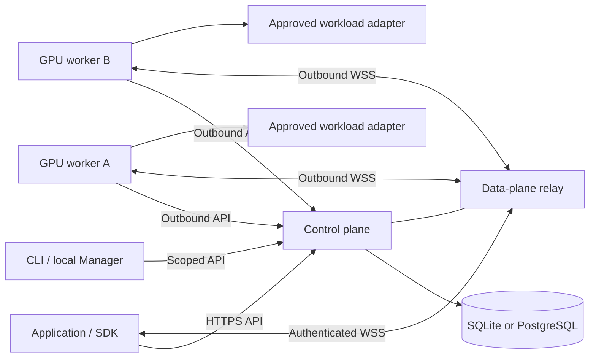

# GPULink

GPULink is an open-source, self-hosted GPU execution platform for running
application workloads on distributed GPU workers. Applications submit durable
jobs or open streaming sessions through a control plane that schedules work on
eligible GPUs and manages resource ownership.

[Website and documentation](https://gpulink.dev) · [Public preview release](https://github.com/JCrossoverGithub/GPULink/releases/tag/gpulink-v0.1.0-preview.1) · [Getting started](docs/GETTING_STARTED.md)

## Install

GPULink 0.1.0 is available as a public preview. The CLI and npm SDKs require
Node.js 24 or newer; the .NET SDK targets .NET 10.

| Package | Install |
| --- | --- |
| [CLI and Core](https://www.npmjs.com/package/@gpulink/cli) | `npm install -g @gpulink/cli@0.1.0` |
| [TypeScript / JavaScript client](https://www.npmjs.com/package/@gpulink/client) | `npm install @gpulink/client@0.1.0` |
| [Adapter SDK](https://www.npmjs.com/package/@gpulink/adapter-sdk) | `npm install @gpulink/adapter-sdk@0.1.0` |
| [.NET client](https://www.nuget.org/packages/GPULink.Client/0.1.0-preview.1) | `dotnet add package GPULink.Client --version 0.1.0-preview.1` |

Use a user-owned npm installation or prefix; see the [CLI installation guide](docs/CLI_PREVIEW_RELEASE.md).

## Run your first GPU workload

On Linux/WSL with Node.js 24+, an accessible NVIDIA GPU and free loopback
port 8088, follow the [first GPU workload guide](docs/FIRST_GPU_WORKLOAD.md).
It takes you from npm installation through worker registration, one scheduled
GPU diagnostic, result inspection and shutdown. A fresh installation and
explicit consent to execute assignments are required.

For a cluster across machines, use [managed LAN onboarding](docs/MANAGED_LAN_PREVIEW.md)
or [Linux server setup](docs/SERVER_PREVIEW.md). Applications connecting to an
existing authorized cluster only need a client SDK.

## Integrate an application

The client SDK connects to your own deployment or one you are authorized to use.
Set `GPULINK_BASE_URL` and `GPULINK_CLIENT_TOKEN` through private application
configuration. This example assumes an operator has approved and installed the
`external.batch.scale` adapter from the [batch quickstart](docs/DEVELOPER_BATCH_QUICKSTART.md).
Save the example as `scale.mjs` in a Node.js 24+ project with the Client SDK installed. Run `node scale.mjs YOUR_REQUEST_KEY`, using a key persisted by your application for this logical request.

<!-- gpulink-example: readme-scale -->
```js
import assert from 'node:assert/strict';
import { GPULinkClient } from '@gpulink/client';

const requestKey = process.argv[2];
if (!requestKey) throw new Error('Provide a persisted request key');
const client = GPULinkClient.fromEnv(process.env);
const { job } = await client.submitJob({
  projectId: 'scale-example',
  type: 'external.batch.scale',
  constraints: { gpuCount: 1, minVramMiB: 1000 },
  payload: { values: [1, 2, 3] },
  maxAttempts: 1,
}, { idempotencyKey: requestKey });

// Record the job ID before waiting so observation can resume after a timeout.
console.log(job.id);
const terminal = await client.waitForJob(job.id, { timeoutMs: 60_000 });
if (terminal.status !== 'succeeded') throw new Error(`Job ended: ${terminal.status}`);
assert.deepEqual(terminal.result.values, [2, 4, 6]);
assert.equal(terminal.result.backend, 'pytorch-cuda');
console.log(terminal.result);
// Expected with the approved CUDA adapter: { values: [2, 4, 6], backend: 'pytorch-cuda' }
```

Use the [client SDK documentation](packages/gpulink-sdk/README.md) for session
streaming, cancellation, deadlines and durable job observation. The
[Adapter SDK](packages/gpulink-adapter-sdk/README.md) provides workload authoring,
conformance and packaging tools for operator review.

## Architecture



- Capability and VRAM-aware scheduling, model locality, worker inventory and leases.
- Durable job state, cancellation and explicit recovery of uncertain GPU ownership.
- Authenticated streaming sessions for workload-specific binary and text protocols.
- Operator-approved external adapters using a language-neutral subprocess protocol.
- Local browser Manager for workers, jobs, sessions, telemetry and guarded operations.
- SQLite for local installations; PostgreSQL for supported distributed control-plane deployments.

Each assignment uses an eligible GPU; GPULink distributes independent workloads,
not a single model across a shared VRAM address space. Remote connections use
trusted HTTPS/WSS, scoped credentials and explicit operator approval of workloads.
See [architecture](docs/ARCHITECTURE.md) and [security policy](SECURITY.md).

## Demonstrated workloads

| Example | Accepted scope |
| --- | --- |
| CaptionLink | Real Multitalker speech inference across two physical machines over HTTPS/WSS (October 20, 2026); [integration evidence](docs/GETTING_STARTED.md#what-has-actually-been-proven). |
| Vector search | Independent application and CUDA worker, correct result and teardown (November 25); [example](examples/vector-search/README.md), [acceptance](docs/acceptance/independent-vector-search-2026-11-25.md). |
| GPULink Manager | Two-host installed workflow with GPU telemetry, physical CUDA work and drain/resume (November 26); [acceptance](docs/acceptance/installed-manager-two-host-2026-11-26.md). |

The November 25 vector-search run returned these exact top-three results on a
remote RTX 3090 Ti. The application independently checked the ranking, and a
separate process retrieved the persisted result. The November 26 Manager run
also verified queueing while drained and execution after resume.

| Rank | Item | Inner-product score |
| --- | --- | ---: |
| 1 | audio | 95 |
| 2 | video | 93 |
| 3 | render | 88 |

[Reproduce the application](examples/vector-search/README.md) ·
[Inspect the physical acceptance record](docs/acceptance/independent-vector-search-2026-11-25.md)

## Documentation

- [Getting started by role](docs/GETTING_STARTED.md)
- [CLI installation and Manager](docs/CLI_PREVIEW_RELEASE.md)
- [Local lifecycle](docs/CLI_DISTRIBUTION.md), [server](docs/SERVER_PREVIEW.md), [remote worker](docs/REMOTE_WORKER_PREVIEW.md)
- [Managed LAN onboarding](docs/MANAGED_LAN_PREVIEW.md)
- [First external batch workload](docs/DEVELOPER_BATCH_QUICKSTART.md)
- [Application framework](docs/APPLICATION_FRAMEWORK.md), [API](docs/API.md), [adapter contracts](docs/developer-platform/README.md)
- [GPU benchmark](docs/GPU_BENCHMARK.md), [model cache](docs/MODEL_CACHE.md), [legacy operations dashboard](dashboard/README.md)
- [Capability Status](docs/CAPABILITY_STATUS.md), [release evidence](docs/acceptance/public-preview-2026-11-27.md), [roadmap](docs/ROADMAP.md)
- [Production operations](docs/PRODUCTION_OPERATIONS.md) and [historical AWS acceptance](docs/security/aws-phase4e-production-acceptance-2026-10-13.md)

The preview is intended for trusted self-hosted environments. See Capability
Status for platform and execution boundaries, including the lack of hostile-code
isolation and the remaining independent newcomer onboarding work.

## Contributing

See [CONTRIBUTING.md](CONTRIBUTING.md). For Node.js source validation:

```sh
npm ci --ignore-scripts --no-audit --no-fund
npm ci --prefix packages/gpulink-sdk --ignore-scripts --no-audit --no-fund
npm run build --prefix packages/gpulink-sdk
npm test --prefix packages/gpulink-sdk
npm run check
```

Hardware acceptance is explicitly opted in; see the
[installed GPU diagnostic gate](docs/INSTALLED_LOCAL_GPU_DIAGNOSTIC_ACCEPTANCE.md).

## License

Apache-2.0. See [LICENSE](LICENSE). Model weights are not bundled; operators
are responsible for the licenses of their installed models.
